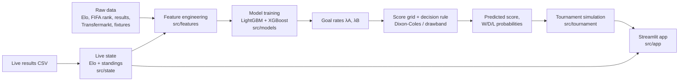

# World Cup Score Predictor

End-to-end machine learning system that forecasts exact football scores and match outcomes for the FIFA World Cup, with dynamic team ratings, chronological backtesting, tournament simulation and a live Streamlit app.

   

## Overview

The project predicts the final score of a match (including extra time for knockout games) rather than only win/draw/loss. A gradient-boosted model estimates the expected goals of each team; those rates are converted to scorelines, outcome probabilities and full-tournament simulations.

Team strength is not static during a tournament, so team state (Elo ratings, rolling form, standings) is updated match by match and fed back into the feature pipeline. The repository keeps every model iteration (V4, V5, V6) side by side so that results can be reproduced and compared.

**Current active implementation:** V6 (see [docs/model-evaluation.md](docs/model-evaluation.md)). V4 is the default model in the Streamlit app; V5 and V6 are selectable from the sidebar.

## Key features

| Status | Feature |
|---|---|
| Implemented | Pre-match feature builder from Elo, FIFA rank, squad market value, rolling form, rest days and tournament context |
| Implemented | LightGBM + XGBoost goal-rate ensemble (Poisson objective) trained on ~21.7k international matches (2004 to mid-2026) |
| Implemented | Dixon-Coles score grid and a "drawband" decision rule for scoreline selection (V6) |
| Implemented | Live tournament state: Elo update on real results, group tables, simulate-forward of remaining fixtures |
| Implemented | Group-stage and knockout simulation, Monte Carlo module, daily update pipeline |
| Implemented | Streamlit app: single-match predictor, 2026 simulation, live tournament view |
| Implemented | Leak-aware evaluation protocol with a held-out World Cup 2022 |
| Experimental | In-tournament form features and a Poisson-Gamma posterior blend (off by default) |

## System architecture



More detail: [docs/architecture.md](docs/architecture.md).

## Technical approach

**Data and features.** One row per historical match describing what was known before kickoff: Elo and rank of both teams, squad and position market values, opponent-adjusted rolling goals for/against, rating change, days since last match, competition importance and in-tournament points/goal difference. Features are expressed as team-A minus team-B differences; training is mirror-augmented so that swapping the two teams gives the mirrored prediction.

**Model.** A 90/10 LightGBM + XGBoost ensemble with a Poisson objective predicts the goal rate of each side. Training rows are weighted by competition importance and by temporal decay relative to the tournament being predicted.

**Scoreline selection.** Independent floors of the goal rates under-produce draws and joint outcomes such as 2-1. V5 uses a conditional floor; V6 adds a calibrated Dixon-Coles grid and predicts the most likely draw scoreline when the grid's draw mass reaches 0.33, otherwise falling back to the conditional floor.

**Evaluation.** Tuning uses four chronological folds (WC 2014, WC 2018, Euro 2024, Copa America 2024) that exclude WC 2022. WC 2022 is reserved as a one-shot holdout. Calibration parameters are cross-fitted on out-of-fold predictions.

**Live state.** Each real result updates Elo (World Football Elo formula with competition-dependent K and a goal-difference multiplier), rankings, rolling windows and group tables. The true state is never mutated by simulation: forward simulation runs on a deep copy.

## Results

All figures below come from files in this repository. Sample sizes are small, so differences of a few points correspond to a few matches.

**World Cup 2022 holdout** (64 matches, never used for tuning; source: [outputs/experiments/v6/V6_REPORT.md](outputs/experiments/v6/V6_REPORT.md))

| Model | Exact score | Outcome (W/D/L) | Goal difference |
|---|---|---|---|
| V4 | 31.2% | 85.9% | 48.4% |
| V5 | 34.4% | 85.9% | 59.4% |
| V6 | 39.1% | 90.6% | 62.5% |

**Live World Cup 2026 predictions** (100 matches: 72 group, 28 knockout; source: `data/raw/world_cup_updates/model_accuracy_v*.csv`)

| Model | Exact score | Outcome (W/D/L) |
|---|---|---|
| V4 | 10.0% | 64.0% |
| V5 | 9.0% | 64.0% |
| V6 | 9.0% | 58.0% |

The 2026 numbers are lower and the V6 ordering does not carry over from the holdout. Plausible reasons are the small sample, the large number of lopsided scorelines in the 2026 group stage that goal-rate models rarely predict as exact scores, and the draw-heavy V6 rule. This is reported as observed, not explained away. See [docs/model-evaluation.md](docs/model-evaluation.md).

## Technology stack

| Area | Tools |
|---|---|
| Language and data | Python, pandas, NumPy, SciPy |
| Modeling | LightGBM, XGBoost, scikit-learn, Optuna, joblib |
| App and visualization | Streamlit, Plotly, Matplotlib, Seaborn |
| Data collection | Requests, BeautifulSoup, Playwright (scrapers only) |
| Testing | pytest |

## Repository structure

```
.
├── src/
│   ├── app/          # Streamlit app (single match, simulation, live tournament)
│   ├── data/         # Loaders and validation
│   ├── features/     # Pre-match feature construction
│   ├── models/       # Training, ensembles, score grid, score conversion, tuning
│   ├── state/        # Elo updates, live tournament state, group tables
│   ├── tournament/   # Bracket, group standings, simulation, Monte Carlo
│   ├── evaluation/   # Chronological backtest, protocol, metrics
│   └── experiments/  # V6 experiment code (isolated from production path)
├── scripts/          # Training, evaluation, simulation, daily update, scraping, audits
├── notebooks/        # Exploration, tuning and evaluation notebooks
├── models/           # Versioned model artifacts and configs
├── data/             # Raw, processed and backup datasets
├── outputs/          # Evaluation outputs and V6 experiment results
├── tests/            # pytest suite (leakage, metrics, scoring, state update)
├── documents/        # Working notes and design/handoff documents
├── docs/             # Architecture, evaluation, planning documents
└── archive/          # Retired scripts and notebooks
```

## Getting started

These commands come from the scripts in this repository; they were not executed as part of the documentation update.

```bash
python -m venv .venv
.venv\Scripts\activate          # Windows
pip install -r requirements.txt
pip install pytest              # not listed in requirements.txt

streamlit run src/app/streamlit_app.py     # app
pytest                                      # tests
python scripts/train_v6.py                  # retrain V6 (see script docstring for options)
python scripts/simulate_2026_world_cup.py   # tournament simulation
python scripts/run_daily_update.py <matchday_csv>   # daily result update pipeline
```

The app expects the model artifacts in `models/` and the CSVs under `data/processed/` and `data/raw/`, which are tracked in this repository. Scraping scripts contact live websites and are not needed to run the app.

## Limitations

- Exact-score prediction is intrinsically noisy; the holdout contains only 64 matches.
- V6 tuning favoured draw prediction; it overshoots draws on the holdout (33% predicted vs 23% actual) and did not outperform on the 2026 matches recorded so far.
- Tree models barely react to in-tournament form; the posterior blend does, but it did not help on the 2022 holdout and is disabled by default.
- Several scripts still hardcode V4/V5 artifact paths and modify `sys.path` rather than using an installed package.

## Data sources

Match results and Elo (eloratings.net), FIFA men's ranking, Transfermarkt squad and position market values, and World Cup 2026 fixtures. Check each source's terms of use before redistributing the raw data.

## License

No license file is currently included in this repository.
